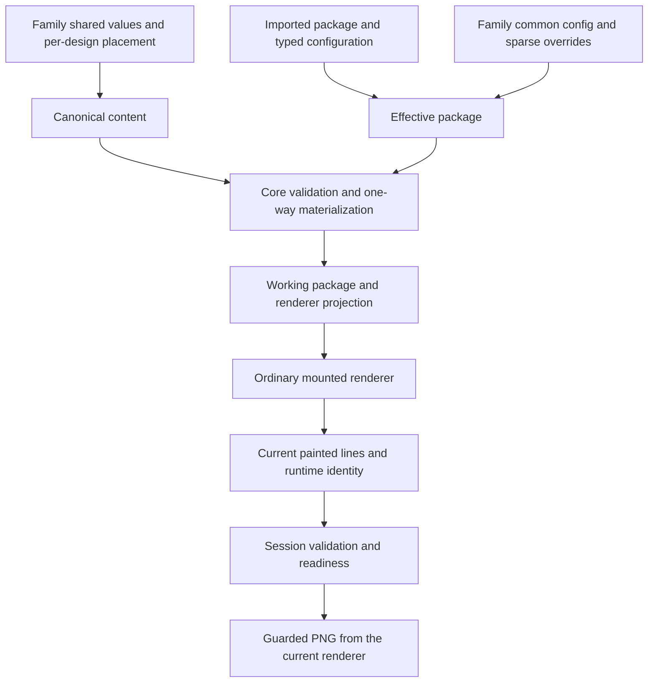

# Field rule → renderer architecture audit — 2026-10-19

## Closure

All three findings below are resolved by the subsequent
[implementation and verification](FIELD_RULE_RENDERER_FIXES_20261019.md).
The original findings describe the audited baseline; the regression script now
asserts them as passing requirements and runs in the standard field-rule gate.

## Verdict

The Core → materializer → renderer → guarded-export foundation is suitable for
continued Studio V2 development. At the audited baseline it was **not yet robust across every supported
single-design and Family flow**. Three boundary defects remain after the earlier
[Studio bug fixes](FIELD_RULES_AUDIT_20261019.md): valid auto-width text can be
rejected, Family image diagnostics can disagree with effective content, and a
native single session can accept old evidence after identical-source reload.

This is an audit of the current working tree on `40faa96`, including the prior
uncommitted fixes. This pass adds a reproducible diagnostic and documentation;
it does not change production behavior, public APIs, schemas, renderer pixels,
user records, fixture bytes, approved references, or tolerances.

## Confirmed findings

### 1. P1 — The Studio line guard can reject valid content before rendering

The [Studio guard](../../apps/studio/src/field-rules/studioTextLimits.ts) rejects
candidates using `measureRenderedTextLines`. That Browser helper fixes its
plain-text mirror to the **previous** node's `clientWidth`
([implementation](../../packages/template-browser/src/editor/textMeasurement.ts)).
A HUG-width text node changes width when its content changes, so this is not a
reliable prediction of the candidate's layout.

Reproduced in Chromium for both single and Family sessions: `Hi` occupies 24px.
`A considerably longer heading` is predicted as 20 lines and rejected by the
Studio guard under `maxLines: 1`. The same candidate, submitted through the native
controller, expands to 326px and receives authoritative **one-line valid**
evidence. Fixed/FILL-width explicit-line boundary agreement passed in the same
probe.

**Effect:** users can be prevented from entering valid text. The renderer and PNG
validation remain correct. This is a disagreement between candidate rejection
and final validation, not evidence of an invalid PNG escaping the bridge.

**Contract needed:** hard line rejection must depend on candidate-current layout,
not previous-width geometry. Keep hard character limits deterministic. Until a
candidate-settlement contract is implemented, restrict mirror vetoes to layouts
whose width and typography are demonstrably stable, and retain painted validation
and export blocking for other layouts. Preserve correction, paste and IME flows.
Do not silently change the documented native controller contract, which permits
render-invalid content to remain editable.

### 2. P2 — Family diagnostics omit effective per-design image placement

[familyFieldIssues](../../apps/studio/src/field-rules/fieldAuthoring.ts) accepts
only `content.values`. It validates each raw shared image against each design's
policy without applying `variantImagePlacements`. The
[Settings caller](../../apps/studio/src/setup/SetupFields.tsx) also memoizes only
that values object, so a placement-only edit cannot refresh these findings.

Reproduced with one shared replacement using Fill and a second design configured
for Fit, with a canonical Fit placement override for that design. Core's
`materializeTemplateFieldFamilyVariantV2` accepts **both designs with no field
issues**. Studio reports `field-v2.image-placement-unauthorized` for the second
design: “fill is incompatible with the fit replacement policy for hero.”

**Effect:** valid content can still receive a false red image diagnostic. The
previous imported-default correction is valid but does not cover this second
provenance case.

**Contract needed:** all-design diagnostics should consume the complete Family
content envelope and current assets, then project Core's effective variant
resolution/materialization issues. Do not independently reconstruct effective
values in a presentation adapter. Include placement-only changes in invalidation.

### 3. P2 — Native single-session reload can resurrect old readiness

[Single-session load](../../packages/template-browser/src/session/templateSessionV2.ts)
clears the current publication generation without retaining a generation
watermark. Its `publishRuntimeReadiness` checks content/materialization identity,
the lease floor and the currently accepted generation; it does not check a load
operation epoch. Reloading identical source recreates the same content revision
and materialization hash under the same publisher lease.

Reproduced without React: load → publish ready runtime and valid lines → reload
the same source → replay the old runtime and lines. All old publications return
`true`, and native `readiness.exportReady` returns to `true` despite the load
operation advancing from 1 to 2. The equivalent Family probe rejects every old
publication and remains pending.

**Boundary:** the ordinary
[React bridge](../../packages/template-react/src/fieldSessionV2.tsx) additionally
compares `operationRevision` in its callback scope and during PNG capture. Those
checks protect Studio's normal publication path. This finding concerns the
framework-neutral native session contract and alternate publishers; no standard
Studio PNG bypass was demonstrated.

**Contract needed:** give single-session invalidation the equivalent generation
watermark/operation ownership already present in Family sessions. Cover identical
load, load A → B → A, reset/reload and restore with one shared native contract
matrix. Preserve the bridge's additional checks.

## Ownership that should remain

- Core owns the seven semantic types, deterministic acceptance, warnings,
  canonical sparse values and exact bindings. Duplicate property bindings are
  rejected during package validation. Renderer nodes do not feed canonical values
  back into content.
- Family resolution produces one effective ordinary package and selected
  package-content state. It uses the same materializer and renderer, rather than
  a separate Family rendering implementation.
- Imported image placement remains source authority; replacement Fill/Fit/Crop
  is explicit content authority. Reset restores imported content. Shared asset
  replacement clears placement overrides tied to the previous asset.
- Painted line evidence carries package, content, materialization, settlement,
  font and generation identity. Warning thresholds are advisory; current required
  pending/invalid evidence blocks PNG. Structurally excluded text is inactive.
- The React bridge renews publication ownership on remount/recovery, scopes async
  font completion, and rechecks identity/revisions throughout export. Runtime
  evidence is transient; persistence retains canonical/configuration authority.

There is no evidence here requiring a rewrite of Core, the materializer or the
renderer. The remaining defects concern duplicated interpretation and incomplete
invalidation at their boundaries. The wider renderer still has capability-routed
Core geometry and compatibility owners; this audit does not promote the proposed
full-surface settled graph to production authority.

## Current-run evidence

[Machine-readable diagnostic](../architecture/evidence/field-rule-patch-20261019/field-rule-renderer-architecture-20261019/report.json)
and [reproduction script](../../scripts/field-rules/architecture-audit.mjs).

| Verification | Result |
| --- | --- |
| `node scripts/run-tests.mjs --portable` | Passed, including all seven Core field types, Browser/session contracts, React consumer smoke tests, persistence/resources and the existing 133-checkpoint native evidence matrix. |
| `node scripts/field-rules/architecture-audit.mjs --check` | Completes all scenarios; deliberately exits 1 for the open diagnostic findings above. 50 checkpoints completed: 46 passed, four diagnostic failures reproduce three distinct defects (the HUG defect occurs in both modes). |
| New real bridge probes, both session kinds | StrictMode initial settlement, three full remounts, font-registry scope replacement, valid boundary warning, native overflow/editability, invalid PNG rejection, mutation during PNG capture, and subsequent successful PNG all passed. Stricter Family selection retains shared text and blocks export. |
| `node scripts/field-rules/audit-regressions.mjs` | Passed both modes: untouched imported images, graphemes, newline/wrapping maxima, composition/rollback, inactive content, repair, stricter Family rules, PNG and recovery completion. |
| `node scripts/field-rules/family-media.mjs` | Passed hash-only restore/decode, guarded PNG, corrupt bytes, missing bytes, and inability of renderer evidence to erase media failure. |

The new guard/paint and native reload probes use isolated synthetic contracts
based on the compact source fixture and system fonts. Family image diagnostics
are compared directly with Core's effective materialization. These are browser
integration and contract results, **not source-design pixel certification** or a
manual inspection of every user design. Font-registry replacement tests ownership
with no exact-font requirement; it does not certify binary font activation.

No full exact-font/fidelity gate was rerun in this audit. The registered
`exporter-061-carrousel` ZIP remains unavailable at its expected path; the prior
`editor:verify` limitation is not resolved or bypassed. Source hashes, command
logs and the missing-path check are recorded in this audit's [verification file](../architecture/evidence/field-rule-patch-20261019/field-rule-renderer-architecture-20261019/verification.json).

## Recommended next milestone

Close the three findings with a candidate-input ownership contract, effective
Family diagnostic projection and shared native invalidation assertions. Then
make this diagnostic's `--check` mode green and rerun the Studio output/IME,
Family media and export-race checks. Keep the wider settled-graph programme and
pixel/reference changes outside that bounded milestone.
